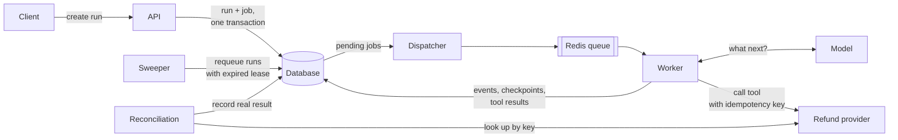

# Agent Harness

A backend service that runs AI agent tasks and makes sure they can survive
crashes without losing work or doing the same thing twice.

## In short

You give the service a task. It runs the agent loop in a background worker,
saves progress after every step, and records everything that happens as a
list of events. If a worker dies halfway through, another worker picks the
task up from the last saved step. If a tool call changes something in the
real world, like refunding an order, the service makes sure it only happens
once, even when retries and crashes get involved.

Built with Python, FastAPI, SQLAlchemy, Celery and Redis, plus a small C++
library that double-checks the recorded data.

## Why I built this

Most agent demos only show the happy path: the model calls a tool, the tool
returns, done. Real systems don't work like that. Workers crash, networks
time out, and sometimes a request succeeds but the reply never comes back.

For a chatbot that only reads data, that's annoying but harmless. For an
agent that can move money, it's a real problem. Retry too eagerly and the
customer gets refunded twice. Give up too early and the task is stuck with
nobody knowing what happened.

I wanted to build the part around the model that makes it safe to let an
agent take real actions: clear rules for what state a task can be in,
recovery after crashes, no duplicate side effects, and enough history to
explain afterwards exactly what the agent did and why.

## How it works

### The big picture

A client creates a run through the API. The API saves the run and a job
for it to the database in one step. The dispatcher picks up that job and
puts it on a Redis queue. A worker takes it from the queue and runs the
agent loop: ask the model what to do, call a tool, save the result, repeat.
Every step is written back to the database as an event and a checkpoint.

Two background jobs clean up when things go wrong. The sweeper finds runs
whose worker died and puts them back in the queue. Reconciliation finds
tool calls where we never got a reply, and asks the outside provider what
actually happened.

The database is the source of truth. Redis only carries "please run this".



### The details

**Runs follow a state machine.** Every run has a status: `queued`, `running`,
`waiting_for_user`, `succeeded`, `failed`, or `cancelled`. Only certain moves
are allowed, and only certain actors can make them. For example, only a
worker can move a run from `queued` to `running`. Once a run is finished, it
can't change again.

**Jobs go through an outbox.** When a run is created, we write the run and a
"job to dispatch" row in the same database transaction. A separate
dispatcher reads those rows and sends them to Celery (backed by Redis). This
way, a run can never be saved without its job, or the other way around. If
sending fails, the dispatcher tries again later with a growing delay.

**Workers hold a lease.** When a worker picks up a run, it gets a lease with
an expiry time. If the worker dies, the lease runs out. A background process
called the sweeper finds those runs and puts them back in the queue. If the
user already asked to cancel, the sweeper cancels the run instead. If a run
has been recovered three times already, the sweeper marks it as failed.

**Progress is saved as checkpoints.** After each step, the agent's context is
saved. When a run is picked up again, it continues from the last checkpoint
instead of starting over.

**Every step is recorded as an event.** Events are numbered in order. You can
replay a run from its events to see exactly what happened. Replay only reads
from the database. It never calls the model or any tool again.

**Tools declare how risky they are.** Each tool says whether it has side
effects, what permission it needs, its timeout, and its risk level. The
runtime enforces a few rules up front: a tool with side effects must use an
idempotency key, and a high-risk tool always needs human approval. When
approval is needed, the run pauses in `waiting_for_user` and gives up its
worker until someone resumes it.

**Tool calls use idempotency keys.** A tool call that changes something in
the outside world, like issuing a refund, gets a stable key. For refunds the
key looks like `refund:<order_id>:<ticket_id>:v1`. The payment provider uses
that key to ignore duplicates, so sending the same request twice is safe.

**Lost responses are marked, not retried.** Sometimes we send a request and
never hear back, so we don't know if it worked. In that case the tool call
is marked `response_lost` instead of being retried.

**Reconciliation fills in the gaps.** A periodic job looks at tool calls
that are stuck in `response_lost` or `running`. It asks the provider "do you
have an operation with this key?" If yes, we record the real result. If no,
we mark the call as failed. If the provider can't answer, we flag the call
for manual review. It never re-sends the original request.

## Example: a refund whose reply gets lost

This is the case the project is mainly built around, and there is a test
for it (`test_fake_gateway_reconciliation_recovers_one_refund`).

1. The agent decides to refund order `ORD-10086`.
2. The tool sends the refund with the key `refund:ORD-10086:T-9527:v1`.
3. The provider processes the refund, but the reply times out.
4. We don't know if the money moved, so the tool call is marked
   `response_lost`. It is not retried.
5. Later, reconciliation asks the provider about that key. The provider
   says the refund exists.
6. The tool call is updated to `succeeded` with the real refund ID.

At the end, the refund request was sent exactly once, and our records match
what actually happened.

## Design choices

- **Outbox instead of sending to Redis directly.** If we saved the run and
  then sent to Redis, a crash in between would leave a run that never
  starts. Writing both in one transaction removes that gap.
- **Don't retry when the result is unknown.** Retrying is only safe if you
  know the first attempt failed. When we don't know, we ask the provider
  instead of guessing.
- **Unknown means manual review, not success or failure.** If reconciliation
  can't reach the provider, it doesn't pick an answer. A person looks at it.
- **The database is the source of truth, not the queue.** Redis only carries
  "please run this". Status, history and recovery all come from the
  database, so losing a message in Redis doesn't lose the run.
- **The model is behind an interface.** The executor talks to a
  `ModelProvider`. Tests use a scripted fake model, so every test gives the
  same result and needs no API key or network.

## The C++ checks

The `cpp/` folder is a small, dependency-free library that checks a run's
recorded history after the fact. It checks that events are in order with
no gaps, that a run's state still makes sense after recovery, and that
refund keys have the right format. Because it is written separately from the
Python code, it can catch bugs on the Python side.

Today it runs in CI and through `validator_cli`, but the Python service
doesn't call it yet. The next step is to run it on real data: export a
run's events and check them, and add the check to CI after the Python
integration tests.

## Project layout

```text
main.py                  FastAPI app
routes/                  HTTP endpoints (runs and debug)
state_machine.py         allowed status changes and who can make them
services/run_executor.py the agent loop: model step, tool step, checkpoints
services/tool_runtime.py tool rules, permissions, timeouts, idempotency
services/reconciliation.py  fixes tool calls whose result is unknown
services/refund_gateway.py  refund client (HTTP and a fake for tests)
repositories/            database reads and writes
dispatcher.py            sends outbox jobs to Celery
worker.py                Celery task that runs one run
sweeper.py               recovers runs whose worker lease expired
cpp/                     C++ consistency checks and the validator CLI
tests/                   Python tests
```

## Requirements

- Python 3.11 or newer
- Redis, if you want to run real background workers
- CMake and a C++17 compiler, for the C++ checks
- For real payments: a refund provider that can look up a refund by its
  idempotency key

## Running it locally

Install dependencies with [uv](https://docs.astral.sh/uv/):

```bash
uv sync --dev
```

If you use pip instead, `requirements.txt` has the same runtime
dependencies. Install `pytest` and `httpx` as well to run the tests.

Start the API:

```bash
uvicorn main:app --reload
```

Run the Python tests:

```bash
PYTHONPATH=. uv run pytest -q
```

## Building and testing the C++ checks

```bash
cmake -S . -B build -DCMAKE_BUILD_TYPE=Release
cmake --build build --parallel
ctest --test-dir build --output-on-failure
```

There is also a small command-line tool. To check a refund key:

```bash
build/cpp/validator_cli \
  key refund:ORD-10086:T-9527:v1 ORD-10086 T-9527
```

To check an event list, pipe it in one event per line, in the form
`event_id run_id sequence event_type`:

```bash
printf 'e1 run_123 1 run.created\ne2 run_123 2 run.completed\n' \
  | build/cpp/validator_cli events
```

The tool exits with `0` if everything is fine, `1` if a check failed, and
`2` if the command was used wrong.

## API

Run endpoints:

```text
POST /runs                    create a run
GET  /runs/{run_id}           get a run
GET  /runs/{run_id}/events    list its events
POST /runs/{run_id}/cancel    cancel it
POST /runs/{run_id}/resume    resume a run waiting for the user
POST /runs/{run_id}/rerun     start a new run from a finished one
GET  /runs/{run_id}/trace     full history for debugging
```

Debug endpoints, for when something looks wrong:

```text
GET  /debug/stuck-runs         runs whose lease has expired
GET  /debug/replay/{run_id}    rebuild a run from its events (read-only)
GET  /debug/queue              how many jobs are waiting in Redis
POST /debug/sweep              run the sweeper once
POST /debug/reconcile          run reconciliation once
```

Note: `/debug/reconcile` has no provider connected yet, so it sends every
uncertain tool call to manual review instead of guessing.

## Configuration

- `REDIS_URL` tells Celery where Redis is.
- `CELERY_QUEUE` is the queue name that `/debug/queue` looks at.
- The HTTP refund client takes the provider's base URL, an API token, the
  refund path, and the path for looking up a refund by key.

## Current limits

These are things the project doesn't do yet, so it's clear what is and
isn't covered:

- No real LLM is connected. The agent loop is tested with a scripted model.
  Plugging in a real one means implementing `ModelProvider`.
- `FakeRefundGateway` is only for tests. Don't use it with real money.
- The `/debug/*` endpoints have no authentication yet. Put them behind
  service auth.
- The app creates its tables on startup, which is fine for development.
  In production, use versioned database migrations instead.
- Reconciliation needs a real refund provider that supports lookup by
  idempotency key.

## CI

On every push and pull request, CI runs the Python tests, builds and tests
the C++ code, and runs a quick smoke test of the command-line tool.
